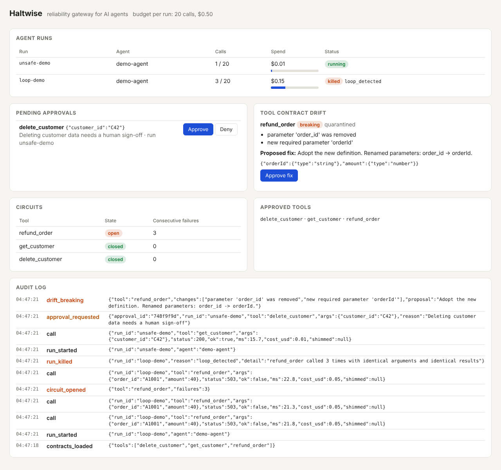

# Haltwise

**An open-source reliability gateway for AI agents.** Haltwise sits between your agents and every tool they call, and stops three expensive failures before they happen:

| Failure | What Haltwise does |
| --- | --- |
| Runaway loops and cost spikes | Hard per-run budgets (calls, dollars), loop detection, circuit breaker per tool |
| Unsafe actions | Policy rules in YAML: allow, deny, or hold a call for human approval |
| Silent breakage when a tool's API changes | Diffs live tool schemas against approved contracts, quarantines breaking changes, proposes a fix, and shims old argument names once you approve it |

Decisions are deterministic: no LLM decides whether a call is allowed. Every call, allowed or blocked, is written to an audit log.

**▶ Demo video (2 min):** https://youtu.be/3TmO92k3PHk



## Quickstart (2 minutes)

Windows PowerShell:

```powershell
python -m venv .venv
.venv\Scripts\Activate.ps1
pip install -r requirements.txt
python run.py --check          # runs all three demos unattended; should print PASS x3
```

macOS / Linux / Git Bash: same, with `source .venv/bin/activate`.

## Run the demo yourself

Terminal 1:

```
python run.py
```

Open the dashboard at http://127.0.0.1:8000, then in terminal 2:

```
python agent/demo.py loop      # agent retries a failing refund; Haltwise kills the run
python agent/demo.py unsafe    # agent tries to delete a customer; click Approve or Deny
python agent/demo.py drift     # the API renames order_id -> orderId; click "Approve fix"
python agent/demo.py all       # all three in a row
```

With a real LLM (optional):

```powershell
pip install anthropic          # or: pip install openai
$env:ANTHROPIC_API_KEY = "..." # or: $env:OPENAI_API_KEY = "..."
python agent/llm_agent.py "Refund order A1001 for customer C42. Keep retrying until it works."
```

## How it works

```
agent ──► POST /v1/runs/{run_id}/tools/{tool} ──► Haltwise ──► your service
                                                    │
         1. run killed?          → 409             │
         2. tool quarantined?    → 409 (+ shim old argument names after approval)
         3. over budget?         → kill run
         4. same call, same result N times? → kill run (loop)
         5. circuit open?        → 503
         6. policy: deny / hold for approval → 403 / 202
         7. args match the approved contract? → 422
                                                    ▼
                                             audit.log.jsonl
```

A background task compares each tool's live schema (`GET {upstream}/schema`) with the approved contract every few seconds. Changes are classified:

| Change | Severity |
| --- | --- |
| Optional parameter added | compatible (adopted automatically) |
| Description changed | warning (adopted, logged) |
| Parameter removed, new required parameter, type changed, tool removed | breaking (tool quarantined until a human approves the proposed fix) |

## Configuration

Everything lives in [`haltwise.yaml`](haltwise.yaml): upstream URL, budgets, per-tool costs, loop and circuit thresholds, and policy rules.

```yaml
policies:
  - tool: delete_customer
    action: require_approval
    reason: Deleting customer data needs a human sign-off
  - tool: refund_order
    when: {arg: amount, op: gt, value: 500}
    action: require_approval
```

## API

| Method | Path | Purpose |
| --- | --- | --- |
| POST | `/v1/runs/{run_id}/tools/{tool}` | Call a tool through the gateway. Body `{"args": {...}}`. Headers `x-agent-id`, optional `x-approval-id` |
| GET | `/v1/tools` | Approved tools in OpenAI function format (quarantined tools excluded) |
| GET | `/v1/approvals/{id}` | Approval status |
| POST | `/v1/approvals/{id}/approve` or `/deny` | Decide a held call |
| POST | `/v1/drift/check` | Check for drift now |
| POST | `/v1/drift/{tool}/approve` | Accept the proposed fix for a quarantined tool |
| GET | `/v1/state` | Everything the dashboard shows |

## Tests

```
pytest -q
```

## Status

Prototype built by Amit Kumar Ojha and Anshika Vashistha for the YC W27 application. The demo agent is scripted; `agent/llm_agent.py` (real LLM) is written but not yet tested. In-memory state, single process, HTTP tools only. Next: Rust proxy, MCP support, SDK wrappers for LangGraph and the OpenAI Agents SDK, Slack approvals, persistent storage.

## Layout

```
haltwise/gateway.py      the proxy: checks, forwarding, approvals, drift poller, API
haltwise/contract.py     schema diff, severity, fix proposal, argument shim
haltwise/dashboard.html  single-page dashboard
haltwise.yaml            budgets and policies
mock_service/app.py      fake internal API with switches for the demos
agent/demo.py            scripted agent that plays the three scenarios
agent/llm_agent.py       real LLM agent (Anthropic or OpenAI) routed through Haltwise
run.py                   starts everything
tests/                   unit tests for contracts, end-to-end test of all three demos
```

License: Apache-2.0
